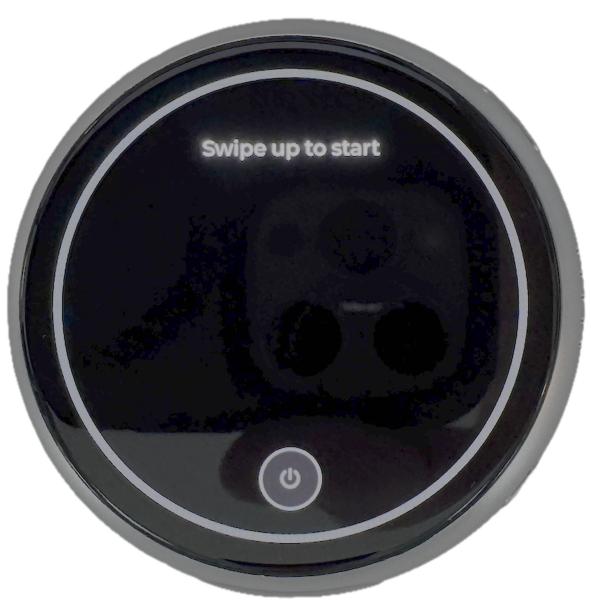
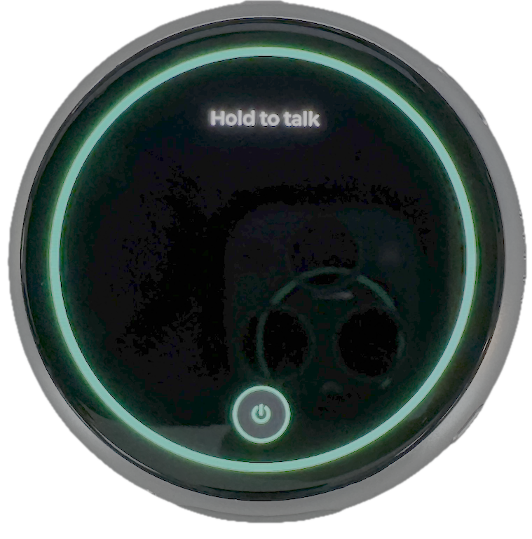
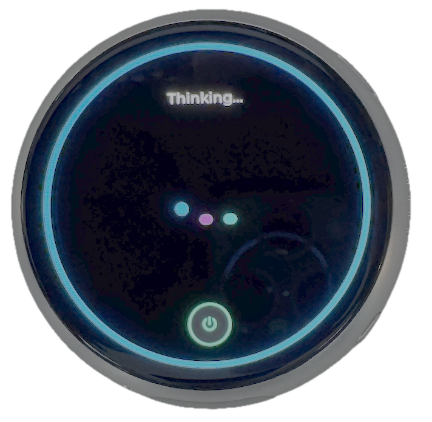
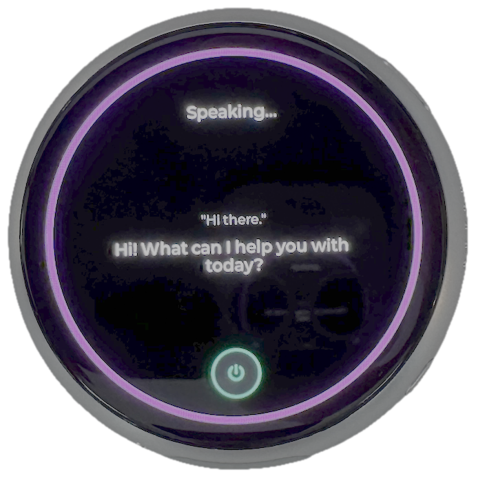

# ESP32-S3-1-75C-fusion-voice-chat — Push-to-Talk Voice Client Application for the ESP32-S3-Touch-AMOLED-1.75C

Touch and hold the round screen, talk, let go. The board records your voice, sends it to your
WebSocket voice server, shows what the server heard and its reply, and plays the reply audio
through the speaker.

```
 hold screen ──► record 16 kHz mono ──► one binary WS frame (WAV) ──► your server
                                                                       (STT → LLM → TTS)
 screen ◄── TRANSCRIBED_REQUEST / RESPONSE (JSON text frames) ◄────────────┤
 speaker ◄── reply audio (binary frames: MP3, WAV or raw PCM) ◄─────────────┘
```

Built with ESP-IDF on top of Waveshare's **1.75C** board support package and its `bsp_extra`
audio helper, the same audio calls as Waveshare's `05_Spec_Analyzer` example, which is known to
work on this board.

> **1.75 vs 1.75C:** these are different boards. The 1.75C has 32 MB flash and a different audio
> clock pin (MCLK on GPIO16 instead of GPIO42). Code for the 1.75 reads silence from the 1.75C's
> microphones. This project only targets the **1.75C**.

## Screen Shots






---

## What's in this folder

This is a complete ESP-IDF project. The base files come from Waveshare's 1.75C `05_Spec_Analyzer`
example (Apache-2.0, see `NOTICE.md`); the voice client is in `main/`.

| File | Purpose |
| --- | --- |
| `main/main.c` | The voice client: Wi-Fi, WebSocket, touch-to-talk, UI, recording, playback |
| `main/minimp3.h`, `main/minimp3_impl.c` | [minimp3](https://github.com/lieff/minimp3) MP3 decoder (CC0 public domain; license in `main/LICENSE.minimp3`) |
| `main/CMakeLists.txt` | Registers the sources and embeds `server_ca.pem`, fetching it from the server on the first build |
| `main/idf_component.yml` | Adds `esp_websocket_client`; keeps LVGL 9.5.0 to match Waveshare |
| `main/secrets.h.example` | Template for Wi-Fi + server settings → copy to `main/secrets.h` (gitignored) |
| `main/server_ca.pem` | Created automatically on the first build: the server's TLS certificate chain (gitignored) |
| `CMakeLists.txt`, `partitions.csv` | Waveshare's project file and 32 MB partition table |
| `components/bsp_extra/` | Waveshare's audio helper (codec, I2S, speaker amplifier) |
| `sdkconfig.defaults` | Waveshare's board settings with this project's settings already appended |
| `sdkconfig.voice` | Just this project's settings (fonts, TLS, PSRAM/DMA memory), for reference |
| `NOTICE.md` | Third-party code and licenses |
| `.gitignore` | Keeps `secrets.h`, `server_ca.pem` and build output out of git |

## Requirements

- A Waveshare **ESP32-S3-Touch-AMOLED-1.75C**
- [ESP-IDF](https://docs.espressif.com/projects/esp-idf/en/stable/esp32s3/get-started/) **5.5 or
  newer**, installed and exported in your terminal (`. $IDF_PATH/export.sh`, or your own alias for it)
- `openssl` on your PATH (preinstalled on macOS and most Linux systems), used once to fetch the
  server certificate
- A 2.4 GHz Wi-Fi network
- A speaker connected to the board's speaker pads/connector
- Your voice server reachable over `wss://`

## Setup

This folder is the complete project: Waveshare's 1.75C base files are included (see `NOTICE.md`).
The only file you create is `main/secrets.h`. The server's TLS certificate is fetched
automatically on the first build.

ESP-IDF does not support paths with spaces, so keep the project out of Dropbox (for example
`~/esp/projects`).

```bash
# 1. Get the project
cd ~/esp/projects
git clone https://github.com/lbrenman/ESP32-S3-1-75C-fusion-voice-chat.git
cd ESP32-S3-1-75C-fusion-voice-chat

# 2. Your settings: Wi-Fi + server URL + API key
cp main/secrets.h.example main/secrets.h
open -e main/secrets.h

# 3. Build, flash, watch the log (board plugged in; exit the monitor with Ctrl-])
. $IDF_PATH/export.sh                  # or your alias, e.g. get_idf
idf.py set-target esp32s3
idf.py build flash monitor
```

On the first build you'll see:

```
-- Fetching TLS certificate chain from <your WS_HOST>:<WS_PORT>
-- Saved 2 certificate(s) to main/server_ca.pem
```

The first build also downloads the BSP, LVGL and the WebSocket client, so it takes a few minutes.
After that, `idf.py build flash monitor` alone is enough for code changes.

If more than one serial device is connected, name the board's port: `idf.py -p PORT flash monitor`.
On macOS it looks like `/dev/cu.usbmodem101` (list them with `ls /dev/cu.usb*`); on Linux,
`/dev/ttyACM0`.

**What's in git and what isn't:** everything in this folder is committed except `main/secrets.h`
(your credentials) and `main/server_ca.pem` (fetched per server). Both are in `.gitignore`, along
with the build output.

## Using it

**On/off:** the app starts **off** ("Swipe up to start", gray ring), so touching the screen does
nothing.

- **Swipe up** anywhere on the screen to switch it on: the ring and the power icon turn green.
- **Swipe down** to switch it off.
- Tapping the power icon at the bottom also toggles it.
- It switches itself off after 2 minutes without use (`AUTO_OFF_MS`).
- If you switch it off while it's thinking or speaking, the reply finishes first.

Swipes and hold-to-talk share the screen. Recording starts the moment your finger lands, so your
first word isn't cut off. If the finger then moves at least 60 px up or down within 0.8 s, the
touch was a swipe, and the recording is discarded instead of sent.

| Ring color | Status text | Meaning |
| --- | --- | --- |
| Amber | Connecting to Wi-Fi... / server... | Starting up or reconnecting |
| Gray | Swipe up to start | Switched off: swipe up (or tap the power icon) to use it |
| **Green** | **Hold to talk** | Ready: touch and hold anywhere, then speak |
| Red | Listening... | Recording (up to 10 s); release to send |
| Blue | Thinking... | Waiting for the server: three colored dots bounce in a wave until the reply arrives |
| Purple | Speaking... | Playing the reply |

- Gray text in quotes is what the server heard (`TRANSCRIBED_REQUEST`).
- The display fonts contain only plain ASCII, so on-screen text is converted first: curly quotes
  become straight quotes, dashes become `-`, `…` becomes `...`, and accented letters lose their
  accents (é becomes e). Emoji are dropped. The spoken reply is unaffected.
- White text is the reply (`RESPONSE`). Both sit in one centered column, so a long reply never
  overlaps the transcript. Replies over 90 characters switch to a smaller font, and anything past
  320 characters is trimmed with "...".
- Taps shorter than 0.3 s are ignored ("Hold while you talk").
- If the server sends text but no audio, the board returns to green after 4 s. With no reply at all
  it gives up after 45 s.

## Protocol (what the device sends and expects)

**Connect:** `wss://WS_HOST:WS_PORT/WS_PATH?x-api-key=<key>&conversationId=<uuid>`.
A new random `conversationId` is generated at each boot. The key is URL-encoded and never logged.

**Send, one binary frame per turn:** a complete WAV file, 16 kHz, mono, 16-bit PCM, 44-byte header.

**Receive:**

- Text frames: a JSON object `{"type": ..., "message": ...}` or an array of them.
  `TRANSCRIBED_REQUEST`, `RESPONSE` and `ERROR` are handled. A JSON object without `type` is shown
  as compact JSON, and non-JSON text is shown as the reply.
- Binary frames: reply audio. The format is detected from the first bytes, and the log shows it
  (`Reply audio: MP3, 15712 bytes, first bytes ...`):
  - **MP3** (`ID3` tag or an `FF Ex`/`FF Fx` frame sync): decoded on the device with minimp3, at any
    sample rate, mono or stereo. A reply split across several messages is decoded as one stream.
  - All reply audio is converted to 16 kHz in software and played without re-clocking the codec.
    Switching the codec's rate rebuilds the I2S driver and briefly starves the display of internal
    DMA memory (`Draw bitmap failed: ESP_ERR_NO_MEM`).
  - **WAV** (`RIFF....WAVE`): 16-bit PCM at any sample rate, mono or stereo.
  - **OGG/Opus** (`OggS`): not supported. The log says so; have the server send MP3 or WAV.
  - Anything else is played as raw 16-bit PCM in the most recent format.
- Close frames: the close code is logged (`1006` = rejected handshake, `1009` = message too big,
  `1011` = server error).

## TLS certificate

The device verifies the server against `main/server_ca.pem`, which is compiled into the firmware.
You don't create it by hand: when it's missing, the build (`main/CMakeLists.txt`) reads `WS_HOST`
and `WS_PORT` from `secrets.h`, runs `openssl s_client -showcerts` against the server, and saves
the certificate chain it presents.

Using the server's own chain works even when the server doesn't send its intermediate
certificate, or uses a CA that's missing from ESP-IDF's built-in bundle. Either case shows up in
the log as `esp-x509-crt-bundle: No matching trusted root certificate found`, and the server never
sees a connection attempt.

**Refresh it** after changing `WS_HOST`, or if the server moves to a certificate from a
different CA (the log shows a TLS handshake error such as `-0x2700` or `-0x3000`):

```bash
rm main/server_ca.pem && idf.py reconfigure && idf.py build flash
```

Routine renewals from the same CA keep working, because the intermediate and root certificates in
the file stay valid.

## Settings you might change (top of `main/main.c`)

| Setting | Default | Notes |
| --- | --- | --- |
| `REC_MAX_SECONDS` | 10 | Longest recording (about 32 KB per second, stored in PSRAM) |
| `SPEAKER_VOLUME` | 75 | 0–100 |
| `TURN_TIMEOUT_US` | 45 s | Give up waiting for a reply |
| `TEXT_ONLY_IDLE_US` | 4 s | Return to ready when a reply has text but no audio |
| `RX_MAX_BYTES` | 3 MB | Largest single message accepted from the server |
| `REPLY_BIG_FONT_CHARS` | 90 | Replies longer than this use the 16 px font |
| `AUTO_OFF_MS` | 2 min | Switch off after this long idle; `0` = never |
| `SWIPE_MIN_PX`, `SWIPE_MAX_MS` | 60 px, 800 ms | How far and how soon the finger must move for a swipe; raise `SWIPE_MIN_PX` if holds get mistaken for swipes |
| `DOT_PERIOD_MS`, `DOT_BOUNCE`, `DOT_STAGGER` | 1000 ms, 22 px, 140 ms | Speed, height and spacing of the thinking animation; dot colors are in `dots_build()` |

## Troubleshooting

Read the serial log first (`idf.py monitor`, or `idf.py -p PORT monitor`). Every step logs under the
`voice_chat` tag.

| Symptom / log | Likely cause | Fix |
| --- | --- | --- |
| Stuck on "Connecting to Wi-Fi..." / `Wi-Fi disconnected (reason 201)` | SSID not found | Check `WIFI_SSID`; use the 2.4 GHz network |
| `reason 15` or `202` | Wrong password | Check `WIFI_PASSWORD` |
| Stuck on "Connecting to server..." + `WebSocket error` | Host, port, path or TLS | Check `WS_HOST`, `WS_PORT`, `WS_PATH`; confirm the URL works from your browser client |
| `Server closed the connection, code 1006` right after connecting | Handshake rejected | Usually the API key; check `WS_API_KEY` |
| `No matching trusted root certificate found` / `-0x3000` / `-0x2700`, nothing in the server logs | Certificate chain not trusted | `rm main/server_ca.pem && idf.py reconfigure`, then build and flash |
| Build stops: `Could not fetch a certificate` | Wrong `WS_HOST`/`WS_PORT`, or server unreachable | Check `secrets.h`; test with the `openssl s_client` command the error prints |
| Build stops: `main/secrets.h is missing` | Fresh clone | `cp main/secrets.h.example main/secrets.h` and fill it in |
| `Recorded 0 ms` or no transcript | Mic not capturing | Confirm the board is a 1.75C, not a 1.75: the 1.75 uses a different audio clock pin |
| `Sent ...` but never "Speaking..." | Server sent no binary audio, or an unsupported format | Check the `Reply audio:` log line for the detected format |
| Reply plays as static/noise | Compressed audio played as raw PCM | Check the `Reply audio:` line: the first bytes show the real format (see Protocol) |
| Code `1009` | Recording too large for the server | Lower `REC_MAX_SECONDS` |
| No sound but `MP3:` or `WAV:` is logged | Speaker not connected, or volume | Check the speaker; raise `SPEAKER_VOLUME` |
| Build error about `lv_font_montserrat_16/20` | Fonts not enabled | Check that `sdkconfig.defaults` contains the lines from `sdkconfig.voice` (add any that are missing), then `rm sdkconfig && idf.py set-target esp32s3` |
| `Draw bitmap failed: ESP_ERR_NO_MEM`, leftover images on screen | Too little internal RAM reserved for display DMA | Check that the `SPIRAM_MALLOC_*` lines from `sdkconfig.voice` are in `sdkconfig.defaults`, then `rm sdkconfig && idf.py set-target esp32s3`. The boot log should show `Reserving pool of 48K` |